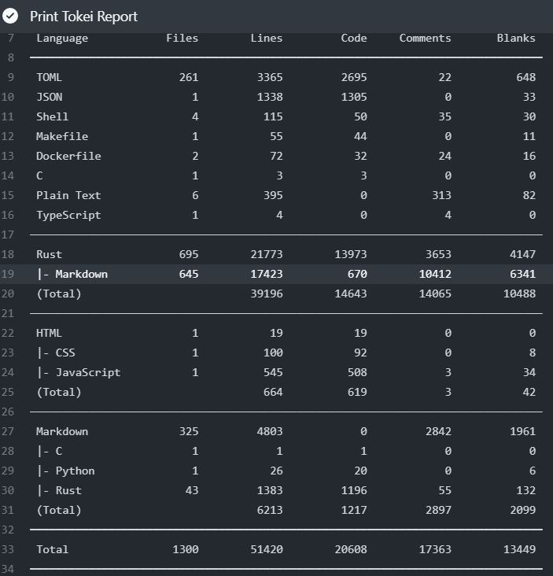
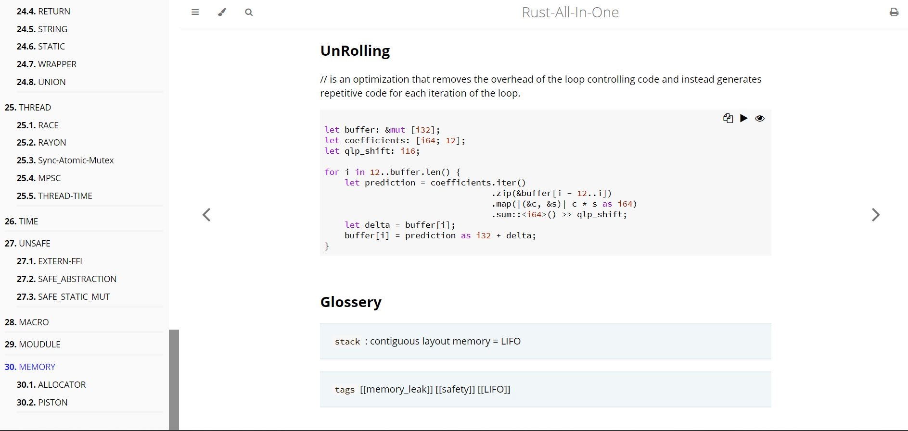
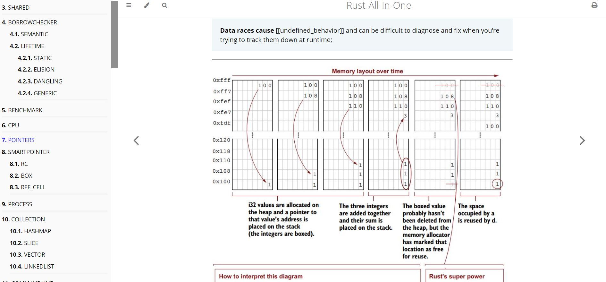
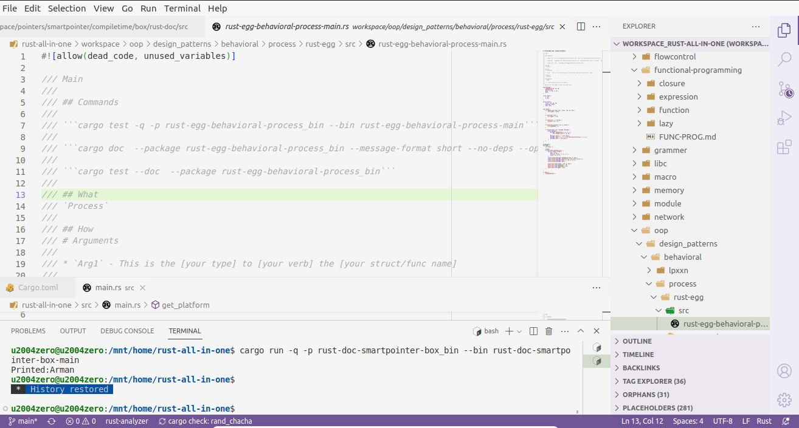

## Best Practices for Mastering Rust

This repository contains over 1K samples that collected of more than 30 significant references, including books and online resources. 

- **Modular Practices**: Each practice is designed to be modular, allowing you to run them independently.
- **Custom Online Book**: I have created a customized online book that includes markdown files for easy navigation and searching. If you're interested, please don't hesitate to reach out!

For access to the **online book and code**, the total value is **$49**. You can contact me directly to obtain the files or explore sponsorship opportunities at armanriazi.uni@gmail.com.

## Author
I have collaborated with OrangeAVA as a technical editor to publish "Mastering Rust for System Programming."

## At a glance 

>

>

>

## Topics

•	Intro RUST

•	TEMPLATE

•	SHARED
________________________________________

•	BORROWCHECKER

o	SEMANTIC

o	LIFETIME

  	STATIC
  
  	ELISION
  
  	DANGLING
  
  	GENERIC
________________________________________

•	BENCHMARK

________________________________________

•	CPU

________________________________________

•	POINTERS

•	SMARTPOINTER

o	RC

o	BOX

o	REF_CELL
________________________________________

•	PROCESS
________________________________________

•	COLLECTION

o	HASHMAP

o	SLICE

o	VECTOR

o	LINKEDLIST
________________________________________

•	COMMANDLINE
________________________________________

•	DATA

o	OPERATOR

o	CONVERT

o	IO

  	FILE

o	REGEX

o	ARITHMETIC

o	SERDE
________________________________________

•	Duplication

o	COPY-CLONE
•	RC
________________________________________

•	ERROR-HANDLING

o	ERROR_NONRECOVERABLE
________________________________________

•	FEATURE
________________________________________

•	FLOWCONTROL

o	FOR

o	LOOP

o	WHILE

o	MATCH
________________________________________

•	FUNCTION PROGRAMMING

o	CLOSURE

o	FUNCTION

o	LAZY
________________________________________

•	LIBC
________________________________________

•	NETWORK
________________________________________

•	OOP

o	TRAIT

•	DESIGN_PATTERN

o	STATE_PATTERN

o	BEHAVIOARAL

  	LPXXN
  	PROCESS

o	CREATIONAL

  	LPXXN

o	STRUCTRUAL

  	LPXXN
________________________________________

•	TRAIT

o	ASSOCIATE

o	INHERITANCE

o	SHARED_BEHAVIOR

  	SAFE OBJECT

  	TRAITOBJECT

  	NON_OBJECTSAFE
  
  	SB_TRAIT_BUILTIN

  	SB_AGGRIGATOR

o	BUILT_IN
________________________________________
•	TYPES

o	NUM

o	GENERIC

o	PRIMITIVE

o	RETURN

o	STRING

o	STATIC

o	WRAPPER

o	UNION
________________________________________

•	THREAD

o	RACE

o	RAYON

o	Sync-Atomic-Mutex

o	MPSC

o	THREAD-TIME
________________________________________

•	TIME
________________________________________

•	UNSAFE

o	EXTERN-FFI

o	SAFE_ABSTRACTION

o	SAFE_STATIC_MUT
________________________________________

•	MACRO
________________________________________

•	MOUDULE
________________________________________

•	MEMORY

o	ALLOCATOR

## Reference

[Personal Website-Rust](https://armanriazi.github.io/site/public/programming/rust/rust/)
